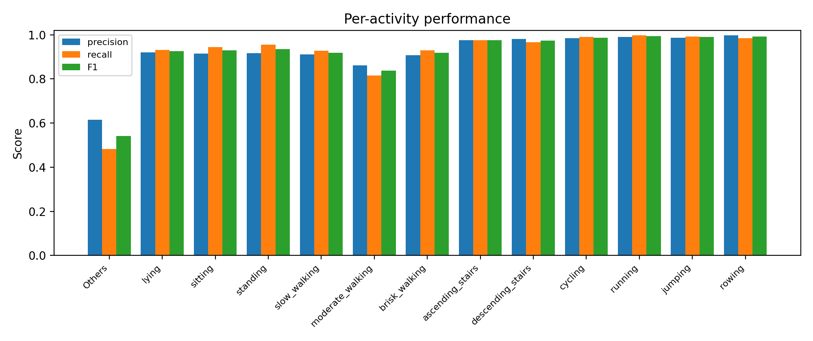
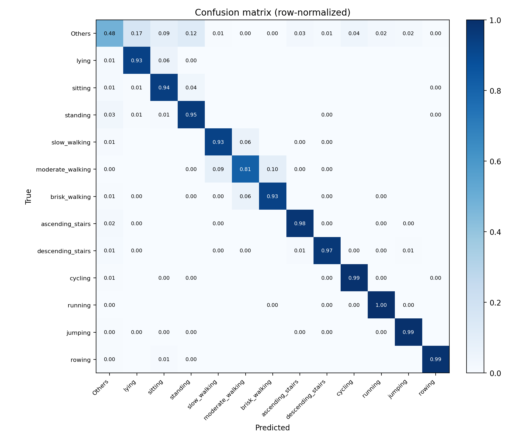
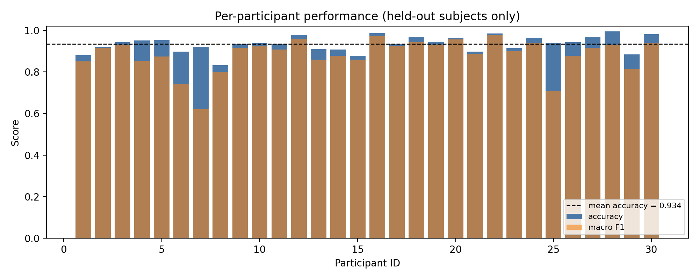

# 任务一：姿态与活动分类（17 单元基线）

> 本文件由 `src/run_task1.py` 自动生成。数值结果见 `metrics/`，图见 `figures/`。

## 1. 数据概况

- 受试者：30 人；总样本：13,454,722 行（约 62.29 小时 @ 60 Hz）
- 单个受试者时长：55.1 – 146.5 分钟
- 活动段（trial 内标签连续段）：5,871 个

| pid | rows | duration_s | segments | windows | seconds_used | source | elapsed_s |
| --- | --- | --- | --- | --- | --- | --- | --- |
| 1 | 498270 | 8304.500 | 202 | 7985 | 8287.300 | cache | 15.700 |
| 2 | 522108 | 8701.800 | 248 | 8315 | 8687.100 | csv | 24.900 |
| 3 | 475513 | 7925.200 | 212 | 7580 | 7897.000 | csv | 30.000 |
| 4 | 415804 | 6930.100 | 167 | 6636 | 6880.700 | csv | 34.600 |
| 5 | 465095 | 7751.600 | 199 | 7425 | 7728.100 | csv | 21.200 |
| 6 | 390873 | 6514.600 | 171 | 6254 | 6506.700 | csv | 18.100 |
| 7 | 308779 | 5146.300 | 127 | 4941 | 5133.700 | csv | 14.500 |
| 8 | 476002 | 7933.400 | 196 | 7549 | 7835.100 | csv | 25.600 |

（仅展示前 8 人，完整表见 `prepare_summary.csv`）

**窗口层面的类别分布**（每个窗口只含一种活动；含切换的窗口已被剔除）：

| label | activity_cn | windows | share |
| --- | --- | --- | --- |
| 0 | 其他 | 6667 | 0.031 |
| 1 | 躺卧 | 17120 | 0.080 |
| 2 | 坐 | 21547 | 0.101 |
| 3 | 站 | 19063 | 0.089 |
| 4 | 慢走 | 18192 | 0.085 |
| 5 | 中速走 | 18136 | 0.085 |
| 6 | 快走 | 18810 | 0.088 |
| 7 | 上楼梯 | 12717 | 0.059 |
| 8 | 下楼梯 | 11568 | 0.054 |
| 9 | 骑行 | 18210 | 0.085 |
| 10 | 跑步 | 18084 | 0.084 |
| 11 | 跳跃 | 17345 | 0.081 |
| 12 | 划船 | 16879 | 0.079 |

## 2. 实验设置与方法

- 时间窗：2.0 s（120 采样），重叠 50%，步长 60 采样
- 特征：`compact` 特征集，共 2312 维；每个特征都归属于某个传感器单元
- 划分：按受试者 6 折交叉验证（GroupKFold），测试受试者完全不参与拟合
- 模型：hgb，类别权重 `balanced`
- Others 处理：`include`
- 窗口样本量：214338
- 实际合并折数：6 / 6
  （如少于总折数，说明有折尚未跑完；指标只覆盖已完成的折）

**如何处理时间维与活动切换**

本题的硬约束是「不同 trial 的记录不得拼接」。实现方式是把每个受试者的序列先在 trial 边界处切开，再在 trial 内部按标签是否变化切成「单一活动段」，窗口只在段内生成。因此：(a) 没有窗口跨越 trial；(b) 没有窗口跨越活动切换点，切换瞬间的过渡样本被自然剔除；(c) 短于一个时间窗（或短于 min_segment）的段直接丢弃。

**Others 类别**

- `include`：把 Others 当第 13 类训练与评估，模型必须显式区分「杂项」；
- `drop`：训练与评估都剔除 Others（等价于作者基线脚本的做法），指标只反映 12 个具名活动；
- `reject`：只用 12 个具名活动训练，再在训练受试者内部切一份验证集，用宏 F1 选一个置信度阈值 τ，测试时最大类别概率 < τ 即判为 Others。

## 3. 结果总览

| 指标 | 数值 |
| --- | --- |
| 准确率 accuracy | 0.9344 |
| 平衡准确率 balanced accuracy | 0.9145 |
| 宏平均 F1 macro-F1 | 0.9165 |
| 加权 F1 weighted-F1 | 0.9329 |
| Cohen κ | 0.9285 |
| 样本数 | 214338 |

## 4. 逐活动性能

| label | activity_cn | activity | support | precision | recall | f1 |
| --- | --- | --- | --- | --- | --- | --- |
| 0 | 其他 | Others | 6667 | 0.615 | 0.483 | 0.541 |
| 1 | 躺卧 | lying | 17120 | 0.920 | 0.931 | 0.925 |
| 2 | 坐 | sitting | 21547 | 0.914 | 0.944 | 0.929 |
| 3 | 站 | standing | 19063 | 0.916 | 0.955 | 0.935 |
| 4 | 慢走 | slow_walking | 18192 | 0.911 | 0.927 | 0.919 |
| 5 | 中速走 | moderate_walking | 18136 | 0.862 | 0.815 | 0.838 |
| 6 | 快走 | brisk_walking | 18810 | 0.908 | 0.929 | 0.918 |
| 7 | 上楼梯 | ascending_stairs | 12717 | 0.976 | 0.975 | 0.976 |
| 8 | 下楼梯 | descending_stairs | 11568 | 0.981 | 0.967 | 0.974 |
| 9 | 骑行 | cycling | 18210 | 0.984 | 0.989 | 0.986 |
| 10 | 跑步 | running | 18084 | 0.989 | 0.997 | 0.993 |
| 11 | 跳跃 | jumping | 17345 | 0.987 | 0.993 | 0.990 |
| 12 | 划船 | rowing | 16879 | 0.997 | 0.985 | 0.991 |



## 5. 混淆结构



最主要的错误方向（真实 → 预测）：

| true_name | pred_name | count | rate_of_true |
| --- | --- | --- | --- |
| moderate_walking | brisk_walking | 1761 | 0.097 |
| moderate_walking | slow_walking | 1553 | 0.086 |
| brisk_walking | moderate_walking | 1214 | 0.065 |
| slow_walking | moderate_walking | 1144 | 0.063 |
| Others | lying | 1102 | 0.165 |
| lying | sitting | 953 | 0.056 |
| Others | standing | 832 | 0.125 |
| sitting | standing | 800 | 0.037 |
| standing | Others | 597 | 0.031 |
| Others | sitting | 580 | 0.087 |
| Others | cycling | 287 | 0.043 |
| sitting | Others | 256 | 0.012 |

## 6. 跨受试者稳定性



| pid | n_windows | accuracy | macro_f1 | n_classes_present |
| --- | --- | --- | --- | --- |
| 1 | 7985 | 0.880 | 0.850 | 13 |
| 2 | 8315 | 0.919 | 0.913 | 13 |
| 3 | 7580 | 0.943 | 0.928 | 13 |
| 4 | 6636 | 0.951 | 0.924 | 12 |
| 5 | 7425 | 0.952 | 0.947 | 12 |
| 6 | 6254 | 0.897 | 0.876 | 11 |
| 7 | 4941 | 0.921 | 0.896 | 9 |
| 8 | 7549 | 0.832 | 0.800 | 13 |
| 9 | 8071 | 0.934 | 0.913 | 13 |
| 10 | 6966 | 0.938 | 0.925 | 13 |
| 11 | 6430 | 0.933 | 0.907 | 13 |
| 12 | 8165 | 0.978 | 0.960 | 13 |
| 13 | 6157 | 0.909 | 0.859 | 13 |
| 14 | 6656 | 0.907 | 0.876 | 13 |
| 15 | 7988 | 0.877 | 0.859 | 13 |
| 16 | 7682 | 0.986 | 0.972 | 13 |
| 17 | 7642 | 0.932 | 0.926 | 13 |
| 18 | 6720 | 0.967 | 0.943 | 13 |
| 19 | 7825 | 0.944 | 0.931 | 13 |
| 20 | 8359 | 0.964 | 0.957 | 13 |
| 21 | 8455 | 0.898 | 0.885 | 13 |
| 22 | 7699 | 0.984 | 0.977 | 13 |
| 23 | 7584 | 0.913 | 0.898 | 13 |
| 24 | 7142 | 0.965 | 0.940 | 13 |
| 25 | 3066 | 0.939 | 0.919 | 10 |
| 26 | 6822 | 0.943 | 0.877 | 13 |
| 27 | 6971 | 0.967 | 0.916 | 13 |
| 28 | 6929 | 0.994 | 0.928 | 13 |
| 29 | 7063 | 0.884 | 0.814 | 13 |
| 30 | 7261 | 0.981 | 0.939 | 13 |

## 7. 各折结果

| fold | test_pids | n_train | n_test | accuracy | macro_f1 |
| --- | --- | --- | --- | --- | --- |
| 1 | 08 17 25 26 30 | 181998 | 32340 | 0.923 | 0.893 |
| 2 | 06 11 22 23 27 | 179400 | 34938 | 0.940 | 0.926 |
| 3 | 07 10 19 20 21 | 177792 | 36546 | 0.934 | 0.920 |
| 4 | 01 04 16 18 24 | 178173 | 36165 | 0.949 | 0.927 |
| 5 | 03 12 13 15 29 | 177385 | 36953 | 0.919 | 0.902 |
| 6 | 02 05 09 14 28 | 176942 | 37396 | 0.941 | 0.923 |

## 8. 自动结论

- **总体**：准确率 0.934，平衡准确率 0.914，宏平均 F1 0.916，加权 F1 0.933，Cohen κ 0.929。
- **最弱的三类**：其他（F1=0.541，支持=6667）、中速走（F1=0.838，支持=18136）、快走（F1=0.918，支持=18810）。
- **最强的三类**：跑步（F1=0.993）、划船（F1=0.991）、跳跃（F1=0.990）。
- **主要混淆**：moderate_walking→brisk_walking（1761 次，占该类 9.7%）；moderate_walking→slow_walking（1553 次，占该类 8.6%）；brisk_walking→moderate_walking（1214 次，占该类 6.5%）；slow_walking→moderate_walking（1144 次，占该类 6.3%）；Others→lying（1102 次，占该类 16.5%）。
- **跨受试者波动**：单人准确率均值 0.934，标准差 0.037，范围 0.832–0.994。

### 这些错误揭示了什么

- 约 57% 的错误发生在同一类活动族内部（步行强度 / 静态姿态 / 楼梯 / 器械）。这说明模型已经抓住了粗粒度信息，缺的是「强度」或「角度」这一层的细分辨力——属于**特征信息量**的限制，而不是分类器容量不足。
- 步行三档内部互错占全部错误的 40%。慢走/中速走/快走是**同一动作的连续强度**，2 s 窗内的主频与谱质心差异很小，类边界本身带有主观性；这部分误差是**信息层面的**，换更强模型收益有限，要改善只能加长窗口、或引入步频/步长/对称性等专门特征。
- 躺/坐/站之间的互错占 15%。三者运动能量都接近零，唯一可用的区分信息是重力在各轴的投影（即躯干倾角）；而这个信息会被**佩戴朝向差异**污染，所以个体间的安装误差会直接变成标签误差——这解释了跨受试者性能波动的主要来源。
- 上/下楼梯、骑行、划船、跳跃的 F1 均在 0.97 以上：这些活动有独特的角速度周期结构，信息高度冗余。也就是说在「信息充足」的活动上，17 单元布局是过剩的——这为任务二的裁剪留出了空间。
- Others 的 F1 仅 0.54，与 Others 相关的错误占 39%。这不是模型弱，而是 **Others 本身是异质集合**（多种未命名动作被并进同一标签），类别定义的不确定性直接构成了性能上限。部署时应把它当「拒识类」而非第 13 个普通类别。

## 9. 复现

```bash
python -m src.run_task1 --stage prepare --window 2.0 --overlap 0.5 --feature-set compact --others-mode include
python -m src.run_task1 --stage train --n-splits 6 --model hgb --others-mode include
```
